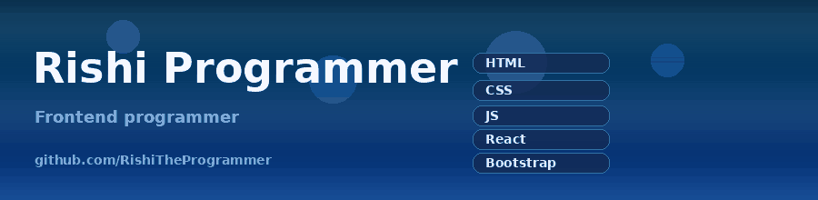
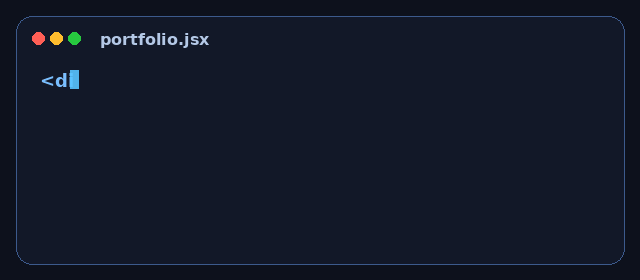

---

## About

Hey, I'm Rishi. I build modern frontend interfaces with **Next.js**, **React**, **GSAP**, and **Bootstrap**.

I care about clean layout, responsive grids, and motion that helps the page instead of getting in the way. Right now I'm also learning **Python**, **Three.js**, and **Spline** so I can add more interactive and 3D work later.

- Building with Next.js, React, HTML, CSS, JavaScript, GSAP, and Bootstrap
- Exploring 3D with Three.js and Spline
- Learning Python fundamentals
- Open to frontend practice, UI polish, and small collaborations

## Current stack

| Area | Tools |
| --- | --- |
| Framework | Next.js, React |
| Markup & style | HTML, CSS, Bootstrap |
| Logic | JavaScript |
| Motion | GSAP |
| Tools | Git, GitHub, VS Code, Vercel |

## Learning

| Learning | Focus |
| --- | --- |
| Python | Programming fundamentals |
| Three.js | 3D on the web |
| Spline | Interactive 3D design |

## Projects

<table>
  <tr>
    <td width="50%" valign="top">
      <h3 align="center">Portfolio</h3>
      

        Personal site built with React, Next-style frontend patterns, Bootstrap, and GSAP.
      

      

        <a href="https://rishitheprogrammer.vercel.app">Live site</a>
        ·
        <a href="https://github.com/RishiTheProgrammer/Portfolio">Source</a>
      

    </td>
    <td width="50%" valign="top">
      <h3 align="center">Admin Dashboard</h3>
      

        React dashboard with modern layout, navigation, and GSAP motion.
      

      

        <a href="https://github.com/RishiTheProgrammer/Admin-Dashboard">Source</a>
      

    </td>
  </tr>
</table>

## GitHub stats

 

## Contribution snake

Generated from the real contribution graph. It updates when the Action runs.

<picture>
  <source media="(prefers-color-scheme: dark)" srcset="https://raw.githubusercontent.com/RishiTheProgrammer/RishiTheProgrammer/output/github-snake-dark.svg"/>
  <source media="(prefers-color-scheme: light)" srcset="https://raw.githubusercontent.com/RishiTheProgrammer/RishiTheProgrammer/output/github-snake.svg"/>
  
</picture>

**Build something clear. Make it move. Make it yours.**

